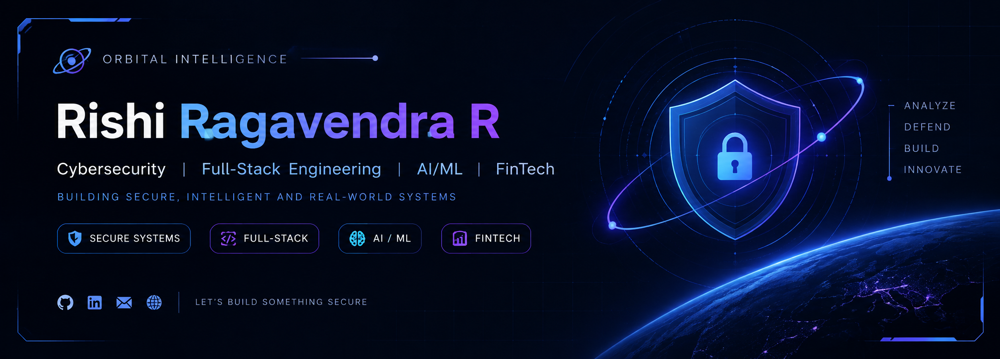

# Hey, I'm Rishi Ragavendra R 👋

### Cybersecurity | Full-Stack Engineering | AI/ML | FinTech

I'm a Computer Science and Engineering undergraduate specializing in **Cyber Security at Chennai Institute of Technology**.

I build real-world software across cybersecurity, financial technology, intelligent systems, and full-stack development.

**[🌐 Portfolio](https://rishiragavendraportfolio.vercel.app/)** · **[💼 LinkedIn](https://www.linkedin.com/in/rishi-ragavendra-rajasekaran-b93801381/)**

---

## About Me

- 🔐 Interested in application security, cybersecurity, and CTF challenges
- 🧠 Building intelligent applications using AI/ML
- 💻 Developing full-stack systems and REST APIs
- 💳 Exploring fintech, secure transactions, and financial intelligence
- 🏗️ Interested in building reliable systems with clear, verifiable outcomes

## Selected Engineering Projects

### 🍯 HoneyChain — Blockchain Supply Chain Provenance
A blockchain-based honey traceability system combining IoT telemetry, smart contracts, lab verification, and supply-chain custody records.

**Stack:** Solidity, Hardhat, TypeScript, Node.js, Docker

### 🛡️ TRACE — Cyber Intelligence Platform
A cybersecurity investigation workbench for analysing darknet marketplace activity, vendor relationships, cryptocurrency flows, and digital evidence.

**Stack:** Python, FastAPI, SQLite, ML

### 💳 CredEcho — Explainable Financial AI
A financial-health scoring platform for MSMEs using alternative financial data and explainable machine learning.

**Stack:** Next.js, TypeScript, FastAPI, PostgreSQL, XGBoost

### 🌊 FloodFax AI — Geospatial Risk Intelligence
A geospatial machine-learning platform for property-level flood-risk assessment and automated vulnerability reporting.

**Stack:** Python, FastAPI, GeoPandas, PostGIS, Next.js

### 🏥 Abyssal Sync — Real-Time Clinic Queue Management
A real-time clinic queue management system designed to improve patient flow and scheduling.

**Stack:** Node.js, Express, Socket.io

---

## Technology Stack

| Domain | Technologies |
|---|---|
| Languages | Python, TypeScript, JavaScript, C++, Solidity |
| Frontend | React, Next.js, Tailwind CSS |
| Backend | FastAPI, Node.js, Express |
| Databases | PostgreSQL, SQLite |
| AI / ML | XGBoost, Machine Learning |
| Security | Linux, Burp Suite, Wireshark, CTF |
| Tools | Git, GitHub, Docker, Hardhat |

---

## Achievements

- 🏆 ExoQuest CTF — 3rd Prize
- 🏅 Trivarna CTF 2.0 — Top 8
- 🏅 CIT Codeathon — Top 22
- 🎯 3× Hackathon / CTF Finalist

---

## GitHub Activity

---

## Connect With Me

🌐 **Portfolio:** https://rishiragavendraportfolio.vercel.app/

💼 **LinkedIn:** https://www.linkedin.com/in/rishi-ragavendra-rajasekaran-b93801381/

**I enjoy building systems that are secure, useful, and explainable.**

<!--
**rishiragavendra/rishiragavendra** is a ✨ _special_ ✨ repository because its `README.md` (this file) appears on your GitHub profile.

Here are some ideas to get you started:

- 🔭 I’m currently working on ...
- 🌱 I’m currently learning ...
- 👯 I’m looking to collaborate on ...
- 🤔 I’m looking for help with ...
- 💬 Ask me about ...
- 📫 How to reach me: ...
- 😄 Pronouns: ...
- ⚡ Fun fact: ...
-->
